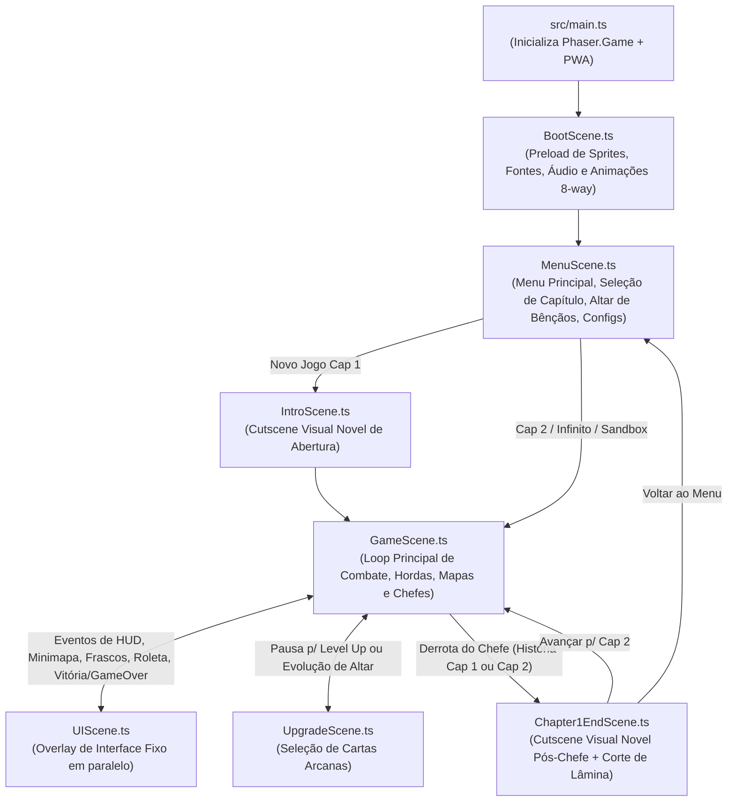

# Arquitetura do Sistema — Hell Survivor (`docs/ARCHITECTURE.md`)

Este documento descreve o mapa real dos módulos, cenas, entidades e sistemas do **Hell Survivor**, detalhando quem chama quem e onde cada responsabilidade mora no código atual.

---

## 1. Visão Geral do Fluxo de Cenas (`src/scenes/`)

---

## 2. Mapa de Diretórios e Responsabilidades (`src/`)

### 2.1. Configuração e Dados (`src/config/`)
| Arquivo | Responsabilidade Real | Quem Consome |
| :--- | :--- | :--- |
| [`gameConfig.ts`](../src/config/gameConfig.ts) | Configuração do `Phaser.Game` (`1280x720`, `pixelArt: true`, Arcade Physics sem gravidade, lista de cenas). | `main.ts` |
| [`balance.ts`](../src/config/balance.ts) | Atributos base da Nixy (`BALANCE.NIXY`), `SOUL_BOLT`, curva de `XP`, `DIRECTIONS_8`, `PERFORMANCE_LIMITS` (120 inimigos, 150 gemas), `ARENA_CONFIG` (`6400x6400`), `getEnemyScaling()` e `ENABLE_DEV_SANDBOX` / `isDevSandboxEnabled()`. | `BaseCharacter`, `Nixy`, `SoulBoltWeapon`, `GameScene`, `MenuScene`, `UIScene` |
| [`mapData.ts`](../src/config/mapData.ts) | Estruturas `ChapterMapConfig`, mapas padrão (`DEFAULT_CHAPTER_1_MAP`, `DEFAULT_CHAPTER_2_MAP`, `DEFAULT_AZAZEL_DIMENSION_MAP` cap. `202`) e `MapStorageManager` (leitura/gravação de mapas customizados no `localStorage`). | `GameScene`, `MapEditorSystem` |

---

### 2.2. Cenas (`src/scenes/`)
| Cena | Papel e Comunicação |
| :--- | :--- |
| [`BootScene.ts`](../src/scenes/BootScene.ts) | Carrega todas as texturas (`nixy`, `succubus`, `azazel`, `mummy`, `zombie-dog`, `blood-bat`, `skull-slime`, props, cartas, ícones, pisos `floor-tile` e `floor-tile-2`) e faixas de áudio (`bgm-menu`, `bgm-battle`, `bgm-boss`, `azazel-intro`, `azazel-mid`, `azazel-fight`). Registra as animações globais de 8/4 direções no `this.anims` e inicia `MenuScene`. |
| [`MenuScene.ts`](../src/scenes/MenuScene.ts) | Renderiza o menu gótico, modal de seleção de capítulo (Cap. 1, Cap. 2, Modo Infinito), loja do **Altar de Bênçãos** (consumindo `MetaProgressManager`), configurações de áudio (`SoundManager`) e botão do **Modo de Teste** (`isDevSandboxEnabled()`). |
| [`IntroScene.ts`](../src/scenes/IntroScene.ts) | Cutscene narrativa inicial antes do Capítulo 1. Usa slides ilustrados, bustos (`420x420`), efeito de máquina de escrever, destaque `[CENSURADO]` (`TextHighlight`) e vozes sintetizadas (`SoundManager`). |
| [`GameScene.ts`](../src/scenes/GameScene.ts) | Orquestrador da partida (`story`, `endless`, `sandbox`). Gerencia a heroína `Nixy`, grupos de física (`enemiesGroup`, `gemsGroup`, `corruptedSoulsGroup`, `mapItemsGroup`), carregamento do mapa (`MapStorageManager`), altares (`EvolutionAltar`, `BossSummonAltar`, `AzazelCrystal`), spawns de hordas e chefes (`SuccubusBoss`, `AzazelBoss`), poças de veneno, balões de fala em combate, colisão, câmera e integração com `UIScene`, `UpgradeScene`, `DevSandboxPanel`, `TestShowroomSystem` e `MapEditorSystem`. |
| [`UIScene.ts`](../src/scenes/UIScene.ts) | Cena paralela (`scrollFactor = 0`) com zoom independente da câmera do mundo. Renderiza frascos góticos de HP e Estamina, barra de XP/Purificação, contador de Almas Corrompidas, barra de vida dos Chefes, Minimapa/Radar tático, frases dramáticas de centro de tela (`showCenterBossPhrase`), Roleta do Baú, modal de Pausa, modal de Game Over (com botão de Ressurreição do Pacto Demoníaco) e modal de Vitória. |
| [`UpgradeScene.ts`](../src/scenes/UpgradeScene.ts) | Cena modal de Level Up e Evolução de Altar. Exibe 3 cartas arcanas com molduras temáticas (`Gold`, `Mystic`, `Fire`, `Inferno`, `Green`, `Ice`, `Obsidian`, `Base`), botões de `Reroll` e `Skip (+20 HP)`, e devolve a escolha para `GameScene` via callback. |
| [`Chapter1EndScene.ts`](../src/scenes/Chapter1EndScene.ts) | Cena Visual Novel pós-vitória contra o chefe do Capítulo 1 (Rosalin) ou Capítulo 2 (Azazel). Inclui sequência interativa de corte diagonal de espada (`Slash Cut`), diálogos estilo *Persona 5* e tela de resumo de vitória com transição para o próximo capítulo ou menu. |

---

### 2.3. Entidades (`src/entities/`)

#### Personagens (`src/entities/characters/`)
- [`BaseCharacter.ts`](../src/entities/characters/BaseCharacter.ts): Classe abstrata sobre `Phaser.Physics.Arcade.Sprite`. Implementa movimento normalizado em 8 direções (`updateMovement`), consumo/regeneração de estamina e cálculo de ângulo para `Direction8`.
- [`Nixy.ts`](../src/entities/characters/Nixy.ts): Heroína jogável. Adiciona modificadores permanentes do `MetaProgressManager`, atributos de run (`bonusDamagePercent`, `bonusSpeedPercent`, `extraProjectiles`, `extraPierce`, `hpRegenPerSec`, `lifeStealPerHit`, `rerollsRemaining`), estados de controle (`slowTimer`, `rootTimer`, `knockbackTimer`, `hurtTimer`, `invulnerableTimer`), animação de morte (`nixy-death-anim`) e rastro fantasma de Sprint (`createSprintGhost`).

#### Inimigos e Chefes (`src/entities/enemies/`)
- [`BaseEnemy.ts`](../src/entities/enemies/BaseEnemy.ts): Classe base para todos os monstros. Gerencia `hp`, `maxHp`, `speed`, `damage`, `stunTimer` (`applyStun` com resistência de 65% em bosses), flash branco de impacto (`hitFlashTimer`), faíscas e chamada ao `DamageTextSystem`.
- **Inimigos Comuns e Elites:**
  - [`ZombieDog.ts`](../src/entities/enemies/ZombieDog.ts): Perseguição terrestre com variante Alfa Elite (`isElite`).
  - [`BloodBat.ts`](../src/entities/enemies/BloodBat.ts): Voador rápido em enxame.
  - [`SkullSlime.ts`](../src/entities/enemies/SkullSlime.ts): Inimigo pulsante com salto/investida curta.
  - [`MummyEnemy.ts`](../src/entities/enemies/MummyEnemy.ts): Caminhada em zigue-zague que deixa poças tóxicas no chão (lentidão + dano periódico na `GameScene`) e aplica knockback no contato.
  - [`Succubus.ts`](../src/entities/enemies/Succubus.ts): Variante menor invocada em ondas avançadas.
- **Chefes de Capítulo:**
  - [`SuccubusBoss.ts`](../src/entities/enemies/SuccubusBoss.ts): Chefe do Capítulo 1 (Imperatriz Rosalin). Máquina de estados (`INTRO`, `CHASE`, `TELEGRAPH_DASH`, `DASHING`, `SHOOTING`, `AIR_JUMP`, `SLAM_IMPACT`, `SLAM_RECOVERY`), usa `DarkOrbProjectile`.
  - [`AzazelBoss.ts`](../src/entities/enemies/AzazelBoss.ts): Chefe do Capítulo 2 (Azazel, O Anjo Caído) + classe `AzazelPhantomClone`. Luta em 4 fases (`1`: 100–50% na arena delimitada com raios, espiral, dash e teleporte; `2`: 50–20% Domínio da Escuridão com 5 cortes telegrafados e 8 clones `AzazelPhantomClone` que compartilham vida com o boss; `3`: Banimento para a dimensão `chao2` onde fica oculto enquanto o jogador captura 3 `AzazelCrystal`; `4`: 20–0% Showdown Final enfurecido).

#### Armas e Projéteis (`src/entities/weapons/`)
- [`BaseWeapon.ts`](../src/entities/weapons/BaseWeapon.ts): Classe base abstrata de armas automáticas. Controla `cooldownMs`, busca o inimigo visível mais próximo dentro da `camera.worldView` (`findClosestEnemy`) e chama `fire()`.
- **6 Armas do Arsenal (Nível 1 a 5 + Forma Evoluída):**
  1. [`SoulBoltWeapon.ts`](../src/entities/weapons/SoulBoltWeapon.ts) + [`SoulBoltProjectile.ts`](../src/entities/weapons/SoulBoltProjectile.ts) → Evolui para **Raio do Apocalipse**.
  2. [`VoidScythesWeapon.ts`](../src/entities/weapons/VoidScythesWeapon.ts) (foices orbitais permanentes ao redor da Nixy) → Evolui para **Ceifadora do Vazio**.
  3. [`HellfireAuraWeapon.ts`](../src/entities/weapons/HellfireAuraWeapon.ts) (pulsos circulares de fogo ao redor da Nixy) → Evolui para **Supernova Abissal**.
  4. [`BloodDaggersWeapon.ts`](../src/entities/weapons/BloodDaggersWeapon.ts) + [`BloodDaggerProjectile.ts`](../src/entities/weapons/BloodDaggerProjectile.ts) (leque direcional de adagas `Adaga.png`) → Evolui para **Chuva de Mil Lâminas**.
  5. [`AbyssalChainsWeapon.ts`](../src/entities/weapons/AbyssalChainsWeapon.ts) (correntes que aplicam `applyStun`) → Evolui para **Prisão de Tártaro**.
  6. [`InfernalMeteorWeapon.ts`](../src/entities/weapons/InfernalMeteorWeapon.ts) (meteoros `Meteoro.png` com círculo telegrafado e explosão em área) → Evolui para **Cataclismo Estelar**.
- [`DarkOrbProjectile.ts`](../src/entities/weapons/DarkOrbProjectile.ts): Projétil hostil disparado por `SuccubusBoss` e `AzazelBoss`.

#### Itens e Estruturas de Mapa (`src/entities/items/`)
- [`SoulGem.ts`](../src/entities/items/SoulGem.ts): Gemas de XP com 3 tiers e atração magnética.
- [`CorruptedSoulItem.ts`](../src/entities/items/CorruptedSoulItem.ts): Moeda de meta-progressão dropada em combate.
- [`MapItem.ts`](../src/entities/items/MapItem.ts): Consumíveis de mapa (`wine` = cura 50% HP, `magnet` = puxa todas as gemas, `chest` = abre roleta na `UIScene`).
- [`EvolutionAltar.ts`](../src/entities/items/EvolutionAltar.ts): Altar de Ascensão (`altar-1` → `altar-2` → `altar-3`) capturado ao permanecer no raio de `65px` até `100%`, emitindo `'altar-completed'`.
- [`BossSummonAltar.ts`](../src/entities/items/BossSummonAltar.ts): Altar de Invocação do Chefe (`altar-invoc-inactive` → `altar-invoc-active-1/2`). Ativa ao atingir 100% de almas do capítulo e emite `'boss-summon-triggered'` quando a Nixy entra no raio de `190px`.
- [`AzazelCrystal.ts`](../src/entities/items/AzazelCrystal.ts): Cristal dimensional da Fase 3 do Azazel (`azazel-crystal`), capturado em 5 segundos permanecendo no raio de `75px`, emitindo `'crystal-completed'`.

---

### 2.4. Sistemas e Utilitários (`src/systems/` & `src/ui/`)
| Sistema | Tipo | Papel e Quem Chama |
| :--- | :--- | :--- |
| [`SoundManager.ts`](../src/systems/SoundManager.ts) | Singleton | Áudio híbrido: gerencia trilhas BGM do Phaser (incluindo máquina de transição musical `intro → mid → fight` do Azazel) + dezenas de efeitos sonoros sintetizados via Web Audio API. Chamado por todas as cenas, armas e chefes. |
| [`MetaProgressManager.ts`](../src/systems/MetaProgressManager.ts) | Singleton | Persistência em `localStorage` de Almas Corrompidas, níveis das 6 bênçãos permanentes (`BLESSINGS_CATALOG`), reembolso de 70% (`refundBlessings`), cálculo de modificadores (`getModifiers`) e estatísticas (`recordRun`, `recordStoryDeath`). |
| [`DialogueSystem.ts`](../src/systems/DialogueSystem.ts) | Instância por `GameScene` | Caixa de diálogo Visual Novel in-game (usada nos encontros e derrotas de Rosalin e Azazel dentro da `GameScene`), com bustos `420x420`, destaque `[CENSURADO]` e suporte a callbacks de sincronia musical (`onLastStepStarted`). |
| [`UltimateSystem.ts`](../src/systems/UltimateSystem.ts) | Instância por `GameScene` | Gerencia a recarga e execução da Habilidade Suprema (*Julgamento do Caos* `[E]`), causando dano massivo em tela e limpando projéteis. |
| [`DamageTextSystem.ts`](../src/systems/DamageTextSystem.ts) | Estático | Exibe números flutuantes de dano com animação sobre inimigos atingidos. Chamado por `BaseEnemy` e armas de área. |
| [`TextHighlight.ts`](../src/systems/TextHighlight.ts) | Utilitário | Aplica coloração dourada automática na substring `[CENSURADO]` em objetos `Phaser.GameObjects.Text`. |
| [`GamepadManager.ts`](../src/systems/GamepadManager.ts) | Singleton | Leitura unificada de controles/gamepads para movimentação em `GameScene` e navegação direcional em `MenuScene`, `UIScene`, `UpgradeScene`, `IntroScene` e `Chapter1EndScene`. |
| [`TouchControls.ts`](../src/ui/TouchControls.ts) | Instância por `UIScene` | Joystick virtual à esquerda e botões de Sprint/Ultimate/Pausa à direita para dispositivos móveis. |
| [`PWAInstallPrompt.ts`](../src/systems/PWAInstallPrompt.ts) | Singleton | Intercepta `beforeinstallprompt` para permitir instalar o jogo como aplicativo desktop/mobile. |
| [`DevSandboxPanel.ts`](../src/systems/DevSandboxPanel.ts) | Instância por `UIScene` | Painel DOM de 5 abas do Modo de Teste (`[F1]`), chamando métodos `sandbox*` da `GameScene` e abrindo a Sala de Teste e o Editor de Mapas. |
| [`TestShowroomSystem.ts`](../src/systems/TestShowroomSystem.ts) | Instância por `GameScene` | Constrói a Galeria Showroom isolada em `(0, -20000)` com todos os sprites do jogo organizados por categoria e teletransportador de entrada/saída. |
| [`MapEditorSystem.ts`](../src/systems/MapEditorSystem.ts) | Instância por `GameScene` | Editor de fases in-game com câmera livre, 4 abas (`Estruturas & Altares`, `Cenário & Props`, `Textura do Chão`, `Checklist Obrigatório`), limites de entidades e exportação/importação JSON via `MapStorageManager`. |
| [`AutoPlayTestAgent.ts`](../src/systems/AutoPlayTestAgent.ts) | Instância por `GameScene` | Bot autônomo (`[F3]`) que pilota a Nixy, faz kiting de inimigos/chefes, coleta gemas/altares e escolhe cartas na `UpgradeScene` para testes automatizados de estabilidade. |
| [`DebugSessionLogger.ts`](../src/systems/DebugSessionLogger.ts) | Singleton | Gravador de sessão que captura logs categorizados, erros globais JS (`window.onerror`), quedas de FPS e snapshots completos do estado da partida para diagnóstico. |
