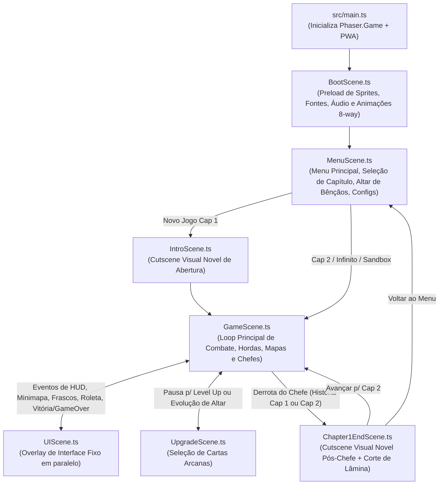

# Arquitetura do Sistema — Hell Survivor (`docs/ARCHITECTURE.md`)

Este documento descreve o mapa real dos módulos, cenas, entidades e sistemas do **Hell Survivor**, detalhando quem chama quem e onde cada responsabilidade mora no código atual.

---

## 1. Visão Geral do Fluxo de Cenas (`src/scenes/`)

---

## 2. Mapa de Diretórios e Responsabilidades (`src/`)

### 2.1. Configuração e Dados (`src/config/`)
| Arquivo | Responsabilidade Real | Onde Moram os Números / Constantes | Quem Consome |
| :--- | :--- | :--- | :--- |
| [`gameConfig.ts`](../src/config/gameConfig.ts) | Resolução de tela base, `pixelArt`, física Arcade sem gravidade e lista ordenada de cenas. | Dimensões em `gameConfig.ts` | `main.ts` |
| [`balance.ts`](../src/config/balance.ts) | Atributos base da heroína, balanceamento de projéteis, curva de XP, limites rígidos de entidades, limites espaciais da arena, escalonamento por minuto e flag do Sandbox. | `BALANCE`, `PERFORMANCE_LIMITS`, `ARENA_CONFIG`, `getEnemyScaling()` | `BaseCharacter`, `Nixy`, `SoulBoltWeapon`, `GameScene`, `MenuScene`, `UIScene` |
| [`mapData.ts`](../src/config/mapData.ts) | Estruturas `ChapterMapConfig`, layouts padrão (`DEFAULT_CHAPTER_1_MAP`, `DEFAULT_CHAPTER_2_MAP`, `DEFAULT_AZAZEL_DIM_MAP` cap. `202`) e `MapStorageManager` (leitura/gravação de mapas customizados no `localStorage`). | Coordenadas e listas de props em `mapData.ts` | `GameScene`, `MapEditorSystem` |

---

### 2.2. Cenas (`src/scenes/`)
| Cena | Papel e Comunicação |
| :--- | :--- |
| [`BootScene.ts`](../src/scenes/BootScene.ts) | Carrega texturas, folhas de sprites, fontes e faixas de áudio. Registra as animações globais de 8/4 direções no `this.anims` e inicia `MenuScene`. |
| [`MenuScene.ts`](../src/scenes/MenuScene.ts) | Renderiza o menu gótico, modal de seleção de capítulo (Cap. 1, Cap. 2, Modo Infinito), loja do **Altar de Bênçãos** (consumindo `MetaProgressManager`), configurações de áudio (`SoundManager`) e botão do **Modo de Teste** (`isDevSandboxEnabled()`). |
| [`IntroScene.ts`](../src/scenes/IntroScene.ts) | Cutscene narrativa antes do Capítulo 1. Apresenta slides ilustrados, bustos de personagens, efeito de máquina de escrever, destaque de `[CENSURADO]` (`TextHighlight`) e vozes sintetizadas via `SoundManager.playDialogueVoice(speaker)`. |
| [`GameScene.ts`](../src/scenes/GameScene.ts) | Orquestrador principal da partida (`story`, `endless`, `sandbox`). Instancia `Nixy`, grupos de física (`enemiesGroup`, `gemsGroup`, `corruptedSoulsGroup`, `mapItemsGroup`), carrega mapa (`MapStorageManager`), altares (`EvolutionAltar`, `BossSummonAltar`, `AzazelCrystal`), gerencia hordas e chefes (`SuccubusBoss`, `AzazelBoss`), colisões e integrações com `UIScene`, `UpgradeScene`, `DevSandboxPanel`, `TestShowroomSystem` e `MapEditorSystem`. |
| [`UIScene.ts`](../src/scenes/UIScene.ts) | Camada de interface fixa paralela (`scrollFactor = 0`). Exibe frascos de vida/estamina, barra de almas, barra de vida dos chefes, radar/minimapa, anúncios dramáticos sem moldura via `showCenterBossPhrase()`, roleta de baú, modais de pausa, Game Over e Vitória. |
| [`UpgradeScene.ts`](../src/scenes/UpgradeScene.ts) | Cena modal de Level Up e Evolução de Altar. Apresenta 3 cartas arcanas estilizadas com molduras temáticas, botões de `Reroll` e `Skip`, devolvendo a escolha para a `GameScene` via callback. |
| [`Chapter1EndScene.ts`](../src/scenes/Chapter1EndScene.ts) | Cena pós-vitória do Capítulo 1 (Rosalin) ou Capítulo 2 (Azazel). Executa corte diagonal de espada na tela (`Slash Cut`), diálogos ilustrados e transição para o próximo capítulo ou menu. |

---

### 2.3. Entidades (`src/entities/`)

#### Personagens (`src/entities/characters/`)
- [`BaseCharacter.ts`](../src/entities/characters/BaseCharacter.ts): Classe abstrata sobre `Phaser.Physics.Arcade.Sprite`. Implementa movimentação vetorial normalizada em 8 direções e gerenciamento de estamina.
- [`Nixy.ts`](../src/entities/characters/Nixy.ts): Heroína jogável. Aplica modificadores de `MetaProgressManager`, atributos de run, estados de controle (`slowTimer`, `rootTimer`, `knockbackTimer`, `hurtTimer`, `invulnerableTimer`), rastro fantasma de sprint e sequência de morte.

#### Inimigos e Chefes (`src/entities/enemies/`)
- [`BaseEnemy.ts`](../src/entities/enemies/BaseEnemy.ts): Classe base de monstros com pooling (`spawn`), cálculo de atordoamento (`applyStun`), flash de impacto e emissão de números de dano via `DamageTextSystem`.
- **Inimigos Regulares:**
  - [`ZombieDog.ts`](../src/entities/enemies/ZombieDog.ts): Terrestre agressivo com variante Alfa Elite.
  - [`BloodBat.ts`](../src/entities/enemies/BloodBat.ts): Voador rápido em bando.
  - [`SkullSlime.ts`](../src/entities/enemies/SkullSlime.ts): Inimigo pulsante com salto curto.
  - [`MummyEnemy.ts`](../src/entities/enemies/MummyEnemy.ts): Movimento em zigue-zague com poças de veneno desacelerantes e knockback no contato.
  - [`Succubus.ts`](../src/entities/enemies/Succubus.ts): Inimigo de suporte avançado.
- **Chefes de Capítulo:**
  - [`SuccubusBoss.ts`](../src/entities/enemies/SuccubusBoss.ts): Chefe do Cap. 1 (Imperatriz Rosalin). Máquina de estados com investida telegrafada, orbes sombrios (`DarkOrbProjectile`) e salto aéreo de impacto.
  - [`AzazelBoss.ts`](../src/entities/enemies/AzazelBoss.ts): Chefe do Cap. 2 (Azazel) + `AzazelPhantomClone`. Combate em 4 fases: arena delimitada, domínio da escuridão com investidas e clones com vida compartilhada, banimento dimensional e confronto final.

#### Armas e Projéteis (`src/entities/weapons/`)
- [`BaseWeapon.ts`](../src/entities/weapons/BaseWeapon.ts): Base abstrata para armas automáticas com busca de alvo dentro da visão da câmera (`findClosestEnemy`) e disparo em cooldown.
- **6 Armas e Evoluções:**
  1. [`SoulBoltWeapon.ts`](../src/entities/weapons/SoulBoltWeapon.ts) + [`SoulBoltProjectile.ts`](../src/entities/weapons/SoulBoltProjectile.ts) → **Raio do Apocalipse**.
  2. [`VoidScythesWeapon.ts`](../src/entities/weapons/VoidScythesWeapon.ts) → **Ceifadora do Vazio**.
  3. [`HellfireAuraWeapon.ts`](../src/entities/weapons/HellfireAuraWeapon.ts) → **Supernova Abissal**.
  4. [`BloodDaggersWeapon.ts`](../src/entities/weapons/BloodDaggersWeapon.ts) + [`BloodDaggerProjectile.ts`](../src/entities/weapons/BloodDaggerProjectile.ts) → **Chuva de Mil Lâminas**.
  5. [`AbyssalChainsWeapon.ts`](../src/entities/weapons/AbyssalChainsWeapon.ts) → **Prisão de Tártaro**.
  6. [`InfernalMeteorWeapon.ts`](../src/entities/weapons/InfernalMeteorWeapon.ts) → **Cataclismo Estelar**.
- [`DarkOrbProjectile.ts`](../src/entities/weapons/DarkOrbProjectile.ts): Projétil hostil de chefes.

#### Itens e Estruturas de Mapa (`src/entities/items/`)
- [`SoulGem.ts`](../src/entities/items/SoulGem.ts): Gemas de XP com 3 tiers e atração magnética.
- [`CorruptedSoulItem.ts`](../src/entities/items/CorruptedSoulItem.ts): Moeda de meta-progressão coletada em combate.
- [`MapItem.ts`](../src/entities/items/MapItem.ts): Consumíveis de exploração (`wine`, `magnet`, `chest`).
- [`EvolutionAltar.ts`](../src/entities/items/EvolutionAltar.ts): Altar de Ascensão dinâmico com zona rúnica circular, emitindo `'altar-completed'`.
- [`BossSummonAltar.ts`](../src/entities/items/BossSummonAltar.ts): Altar de Invocação de Chefe, ativado ao atingir a meta de almas do capítulo e emitindo `'boss-summon-triggered'` por aproximação.
- [`AzazelCrystal.ts`](../src/entities/items/AzazelCrystal.ts): Cristal dimensional da Fase 3 de Azazel com barra circular de purificação e explosão segura.

---

### 2.4. Sistemas e Utilitários (`src/systems/` & `src/ui/`)
| Sistema | Tipo | Papel e Quem Chama |
| :--- | :--- | :--- |
| [`SoundManager.ts`](../src/systems/SoundManager.ts) | Singleton | Gerencia músicas do jogo, máquina de sincronia de Azazel (`finishAzazelIntroAndTransition`), sintetizadores Web Audio e vozes/typewriter de diálogo (`playDialogueVoice`, `playDialogueTypewriter`). |
| [`MetaProgressManager.ts`](../src/systems/MetaProgressManager.ts) | Singleton | Gerencia Almas Corrompidas, bênçãos de `BLESSINGS_CATALOG`, reembolso de 70%, modificadores de partida (`getModifiers`) e estatísticas persistidas no `localStorage`. |
| [`DialogueSystem.ts`](../src/systems/DialogueSystem.ts) | Instância por `GameScene` | Diálogos in-game estilo Visual Novel durante confrontos de chefes, com destaque para `[CENSURADO]` e suporte a sincronia de áudio. |
| [`UltimateSystem.ts`](../src/systems/UltimateSystem.ts) | Instância por `GameScene` | Recarga e execução da Suprema (*Julgamento do Caos*), limpando projéteis e danificando a tela inteira. |
| [`DamageTextSystem.ts`](../src/systems/DamageTextSystem.ts) | Estático | Exibe números flutuantes animados sobre entidades atingidas. |
| [`TextHighlight.ts`](../src/systems/TextHighlight.ts) | Utilitário | Aplica coloração dourada automática na palavra `[CENSURADO]`. |
| [`GamepadManager.ts`](../src/systems/GamepadManager.ts) | Singleton | Leitura de controles/gamepads físicos para gameplay e navegação de menus. |
| [`TouchControls.ts`](../src/ui/TouchControls.ts) | Instância por `UIScene` | Joystick virtual e botões de ação para navegação e combate em dispositivos móveis. |
| [`PWAInstallPrompt.ts`](../src/systems/PWAInstallPrompt.ts) | Singleton | Captura evento de instalação de aplicativo PWA. |
| [`DevSandboxPanel.ts`](../src/systems/DevSandboxPanel.ts) | Instância por `UIScene` | Painel DOM de 5 abas para testes, cheats e acionamento dos módulos de desenvolvimento. |
| [`TestShowroomSystem.ts`](../src/systems/TestShowroomSystem.ts) | Instância por `GameScene` | Constrói galeria isolada fora da arena para inspeção visual de todos os sprites e assets do jogo. |
| [`MapEditorSystem.ts`](../src/systems/MapEditorSystem.ts) | Instância por `GameScene` | Editor de fases in-game com câmera livre, paleta categorizada, checklist em tempo real e exportação/importação JSON. |
| [`AutoPlayTestAgent.ts`](../src/systems/AutoPlayTestAgent.ts) | Instância por `GameScene` | Bot autônomo acionado por `[F3]` para testes automáticos de estresse e longevidade de gameplay. |
| [`DebugSessionLogger.ts`](../src/systems/DebugSessionLogger.ts) | Singleton | Monitora anomalias, erros globais e métricas de desempenho em tempo real, gerando relatórios de diagnóstico. |
