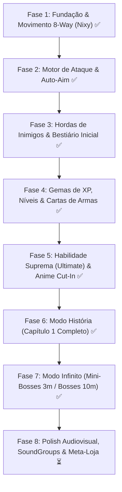

# Linha do Tempo e Roadmap de Desenvolvimento — Hell Survivor

Este documento define as etapas de desenvolvimento para a construção do **Hell Survivor**, garantindo uma fundação sólida, código limpo, balanceamento progressivo e foco constante na diversão e no game loop.

---

## 📌 Visão Geral dos Marcos (Milestones)

---

## 🚀 Detalhamento das Fases

### 🔹 Fase 1: Fundação Técnica & Movimento da Nixy (CONCLUÍDO ✅)
**Objetivo:** Estabelecer a base do projeto, pipeline de sprites, controles fluidos e gerenciamento de estamina.
* [x] **Setup da Stack:** Inicialização do projeto com Vite + TypeScript + Phaser 3.
* [x] **Pipeline de Assets:** Script/processamento para disponibilizar os 8 ângulos da Nixy em `public/assets/sprites/nixy/`.
* [x] **Configuração de Animações:**
  * Carregamento das poses de Idle nas 8 direções (`N, NE, E, SE, S, SW, W, NW`).
  * Geração e registro das animações de corrida nos 8 ângulos (8 frames cada a ~12 FPS).
* [x] **Movimentação do Jogador (`Nixy.ts`):**
  * Suporte a teclado (`WASD` e setas) com cálculo vetorial normalizado (sem bug de andar mais rápido na diagonal).
  * Chaveamento automático de direção angular com base no vetor de movimento.
  * Transição suave entre estados `idle` e `running`.
* [x] **Mecânica de Full Sprint & Estamina:**
  * Consumo contínuo de estamina ao segurar `Shift` ou `Espaço`.
  * Multiplicador de velocidade de movimento e animação durante o sprint com rastro fantasma (ghost trail).
  * Regeneração progressiva de estamina ao caminhar e ao parar.
  * Barra de Estamina visual na HUD do jogador com variação de cor.
* [x] **Câmera & Cenário de Teste:**
  * Câmera do Phaser com lerp suave seguindo a Nixy (zoom 1.5x pixel-perfect).
  * Textura de chão em grid/tile infinito procedural sincronizado com o scroll.

---

### 🔹 Fase 2: Motor de Combate & Auto-Aim (Disparo de Almas) (CONCLUÍDO ✅)
**Objetivo:** Implementar o ataque primário automático com detecção precisa de alvos e alta performance.
* [x] **Arquitetura de Armas (`BaseWeapon.ts`):**
  * Classe abstrata modular que gerencia intervalo de disparo (cooldown), alcance, dano, número de projéteis e velocidade.
* [x] **Implementação da Arma da Nixy (`SoulBoltWeapon.ts`):**
  * Algoritmo de busca rápida pelo monstro vivo mais próximo (`Distance Check`).
  * Cálculo do vetor de disparo direcionado ao alvo com leque angular para disparos múltiplos.
* [x] **Object Pooling de Projéteis (`SoulBoltProjectile.ts`):**
  * Reutilização em pool com limpeza de memória, controle de vida útil e perfuração de alvos.
* [x] **Feedback de Disparo & Impacto:**
  * Projétil místico com núcleo cintilante e aura ciano/espiritual.
  * Efeito de muzzle flash no disparo, flash branco nos monstros ao serem atingidos e faíscas de impacto.
  * Sistema de números flutuantes de dano (`DamageTextSystem.ts`).

---

### 🔹 Fase 3: Sistema de Hordas & Inimigos Iniciais (EM PROGRESSO ⏳)
**Objetivo:** Criar os primeiros monstros e o comportamento de enxame clássico de Vampire Survivors.
* [x] **Classe Base de Inimigo (`BaseEnemy.ts` e `ZombieDog.ts`):**
  * Lógica de perseguição vetorial contínua em direção à heroína.
  * Gerenciamento de HP (35), velocidade (80 px/s), dano de contato (8) e colisão física proporcional.
* [x] **Primeiro Inimigo Oficial Integrado: Zombie Dog (Cão Zumbi):**
  * Poses estáticas nos 8 ângulos de visão (`zombie-dog-idle-${dir}`).
  * Animações de corrida nos 4 eixos cardinais (`zombie-dog-run-${dir}`) com chaveamento direcional dinâmico.
* [x] **Segundo Inimigo Oficial (Futura Chefe da Fase 1): Succubus:**
  * Poses estáticas em 8 ângulos (`64x64px`) e animação completa de voo com asas batendo nos 8 ângulos (`92x92px`, 5 frames por direção a 10 FPS).
  * Atributos de alta ameaça: 85 HP, velocidade rápida de voo (115 px/s) e dano pesado (16).
  * Spawns perimetrais probabilísticos integrados com pooling de memória tipo-seguro.
* [x] **Feedback de Dano e Morte:**
  * Efeito de flash branco temporário no monstro ao ser atingido.
  * Números flutuantes de dano (floating combat text) com cores e animação de subida.
  * Tempo de imunidade (i-frames) no jogador ao receber dano de contato.
* [x] **Interface HUD Barroca Vampírica (Canto Inferior Direito):**
  * Retrato da heroína ampliado para o dobro do tamanho (`340px`), livre sem caixa e com fundo transparente.
  * Frasco alquímico de sangue alado dinâmico cujo líquido drena conforme o HP do jogador.
  * Barras ornamentadas em ouro e veludo vermelho com tipografia pixel art (*Silkscreen / Press Start 2P*).
  * Chaveamento para `damage_ui.png` com tremor orgânico (-6px a +6px) e flash carmesim ao tomar dano.
* [ ] **Pooling de Hordas Massivas & Spawner Escalável:**
  * Spawner com escalonamento por minuto de jogo.

---

### 🔹 Fase 4: Economia de XP, Gemas & Aquisição de Armas via Cartas (CONCLUÍDO ✅)
**Objetivo:** Fechar o ciclo viciante de matar, coletar e evoluir com cartas que concedem melhorias e novas armas.
* [x] **Gemas de Alma no Chão (`SoulGem.ts`):**
  * Drops gerados na posição exata da morte dos monstros.
  * Cores e valores de XP: Verde Esmeralda = 5 XP, Azul Safira = 20 XP, Vermelho Rubi = 100 XP.
* [x] **Física de Ímã e Coleta:**
  * Detecção de proximidade com base no atributo `effectivePickupRadius` da Nixy.
  * Movimento magnético suave acelerando em direção ao herói com faíscas coloridas de absorção.
* [x] **Curva de Progressão e Níveis:**
  * Barra de XP no topo da tela com cálculo dinâmico de XP necessária por nível (`20 * (level ^ 1.25)`).
* [x] **Tela de Seleção de Upgrades (`UpgradeScene.ts`):**
  * Pausa suave da cena de ação ao subir de nível.
  * Sorteio de 3 cartas do catálogo estilo Persona 5 / Barroco:
    * **Cartas de Atributos:** Dano global, velocidade, estamina máxima, raio de coleta, projéteis extras, perfuração, vida máxima e cura.
    * **Cartas de Novas Armas:** Nova arma secundária *Lâminas Orbitais (Void Scythes)* obtida exclusivamente por cartas.
* [x] **Aplicação e Retomada:**
  * Atualização imediata dos atributos, retorno à partida com flash e combate contínuo.

---

### 🔹 Fase 5: Habilidade Suprema (Ultimate): ETERNAL DESPAIR (CONCLUÍDO ✅)
**Objetivo:** Implementar o sistema de carga por abates e a sequência cinematográfica anime de 5 segundos da Nixy.
* [x] **Medidor de Ultimate no Orbe Alado da HUD:**
  * O frasco alquímico alado atua diretamente como medidor de carga da Suprema (0% a 100%).
  * Carregamento orgânico via abates (+2.5% cães, +15% succubus) e absorção de gemas (+0.75% verde, +3% azul, +15% vermelha).
  * Ao atingir 100%, emite chamas douradas nas asas, aura pulsante e badge `[E] READY` clicável por mouse ou ativado por teclado `[E]`.
* [x] **Character Cut-In Cinematográfico Anime:**
  * Corte diagonal fatiando a tela com bordas pretas e brancas de quadrinhos (estilo Persona 5).
  * Close-up dramático na heroína com iluminação carmesim e tipografia angular: `ETERNAL DESPAIR // ★ SUPREME PURIFICATION ★`.
  * Slide acelerado, congelamento de *hit-stop*, flash branco e screen shake.
* [x] **Sequência de 5 Segundos (Time-Stop & Instabilidade):**
  * Todos os monstros da tela paralisados no tempo com animações congeladas e desaturação etérea.
  * Spawner pausado durante a execução do especial.
  * Ambiente escurecido com Nixy mantendo movimentação livre e emitindo pulsos instáveis de aura carmesim.
* [x] **8 Detonações Carmesins com Cluster-Targeting:**
  * 8 explosões circulares consecutivas com telegrafia de runas no chão.
  * Algoritmo de inteligência espacial que localiza e prioriza o ponto de maior densidade de monstros na tela.
  * Ondas de choque em anéis concêntricos, fagulhas infernais, tremores de câmera e 140 de dano AoE massivo por detonação.
* [x] **Desfecho e Retomada:**
  * Flash branco de dissipação, restauração de cores, unfreeze dos monstros sobreviventes e devolução do controle padrão.

---

### 🔹 Fase 6: Modo História (Capítulos & Narrativa) (CONCLUÍDO ✅)
**Objetivo:** Criar a campanha episódica com diálogos teatrais, metas de purificação e chefes predefinidos.
* [x] **Estrutura por Capítulos Independentes:**
  * Cada capítulo possui mapa, meta de monstros e Boss predefinido (Capítulo 1: Catacumbas com a Boss Succubus Imperial).
  * **Reset de Nível:** O jogador sempre volta para o Nível 1 ao iniciar um novo capítulo.
* [x] **Barra de Purificação de Almas (Objetivo da Fase):**
  * Meta fixa de almas/monstros no Capítulo 1 monitorada pela barra barroca no topo.
  * Ao encher em 100%, os monstros comuns são dissipados e a Boss Succubus desce à arena com intro falada.
* [x] **Sistema de Diálogos Estilo Persona 5 (Comic Noir & Balões Angulares):**
  * Balões de fala com polígonos chanfrados, bordas em destaque, nameplate recortada e retratos expressivos de 420px.
  * Transição cinematográfica com balão deslizante e troca de falantes (apenas quando o interlocutor muda).
  * Ocultação automática de toda a HUD durante diálogos e modais de vitória.
  * Efeito de digitação suave (Typewriter FX) e atalhos rápidos (`[Espaço]` / `[Enter]` avançar, `[ESC]` pular).
  * Diálogo 1: Introdução da fase com lore e falas da protagonista Nixy.
  * Diálogo 2: Confronto verbal antes do combate contra a Succubus Imperial.
  * Diálogo 3: Conclusão vitoriosa pós-derrota do Boss com modal de estatísticas e retorno ao menu.
* [ ] **Desbloqueio de Personagens:**
  * Vencer o capítulo desbloqueia novas personagens jogáveis para uso no Modo Infinito.

---

### 🔹 Fase 7: Modo Infinito (Endless / Survival Arcade) (CONCLUÍDO ✅)
**Objetivo:** Arena ilimitada para recordes de tempo, testes de builds extremas e farm de recursos.
* [x] **Motor de Hordas Infinito com Escalonamento por Minuto:**
  * Multiplicadores progressivos contínuos de densidade (até 12 monstros por onda), velocidade e HP.
  * Inclusão de Alfas Elites a partir do minuto 2 (drops aprimorados e carga bônus de Ultimate).
* [x] **Mini-Bosses e Chefes Temporizados:**
  * **Aos 3 Minutos (180s):** Mini-Chefe Titã Cerberus (1400 HP, 1.85x escala, drop de Gema Roxa Lendária).
  * **Aos 6 Minutos (360s):** Mini-Chefe Matriarca Succubus (2400 HP, 1.45x escala, tiros e investidas, drop de 2 Gemas Roxas).
  * **Aos 10 Minutos (600s):** Chefe Suprema Succubus Imperial (4800 HP, barra de vida dinâmica, drop de 3 Gemas Roxas).
* [x] **Gema Roxa Lendária (`gem-purple`):**
  * 250 XP e concessão imediata de +25% de carga da Suprema (Ultimate).
* [x] **HUD de Sobrevivência & Persistência de Recordes (`localStorage`):**
  * Cronômetro ao vivo (`MM:SS`) e Melhor Tempo Pessoal preservado entre sessões.
  * Faixas e avisos táticos de onda (`showWaveAlert`) avisando a aproximação de ameaças.
* [x] **Modal Completo de Fim de Jornada (Game Over):**
  * Estatísticas completas: tempo sobrevivido, abates, nível alcançado e celebração de novo recorde.
  * Botões chanfrados interativos: [ 🔄 TENTAR NOVAMENTE ] e [ 🏠 MENU PRINCIPAL ].

---

### 🔹 Fase 8: Polish Audiovisual & SoundGroups (PRÓXIMA ETAPA ⏳)
**Objetivo:** Elevar o acabamento para padrão comercial.
* [ ] **Sonorização Modular Categorizada (SoundGroups):**
  * Canais dedicados: `SFXGroup` (tiros, gemas, acertos, ultimates) e `MusicGroup` (trilhas de combate e boss).
* [ ] **Efeitos Visuais de Tela (Post-Processing):**
  * Vinheta escura nas bordas e distorções cromáticas em momentos críticos.
